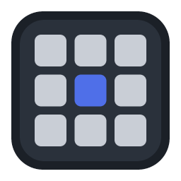
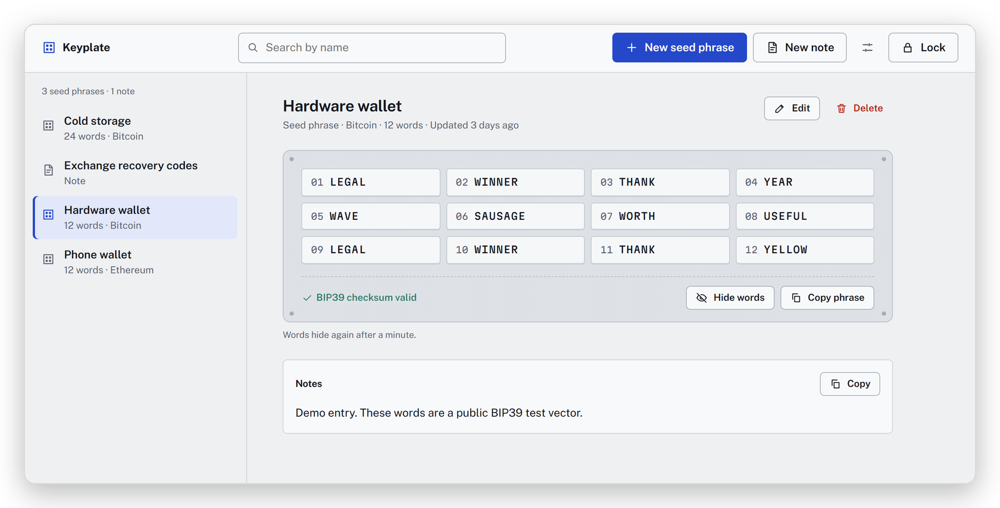
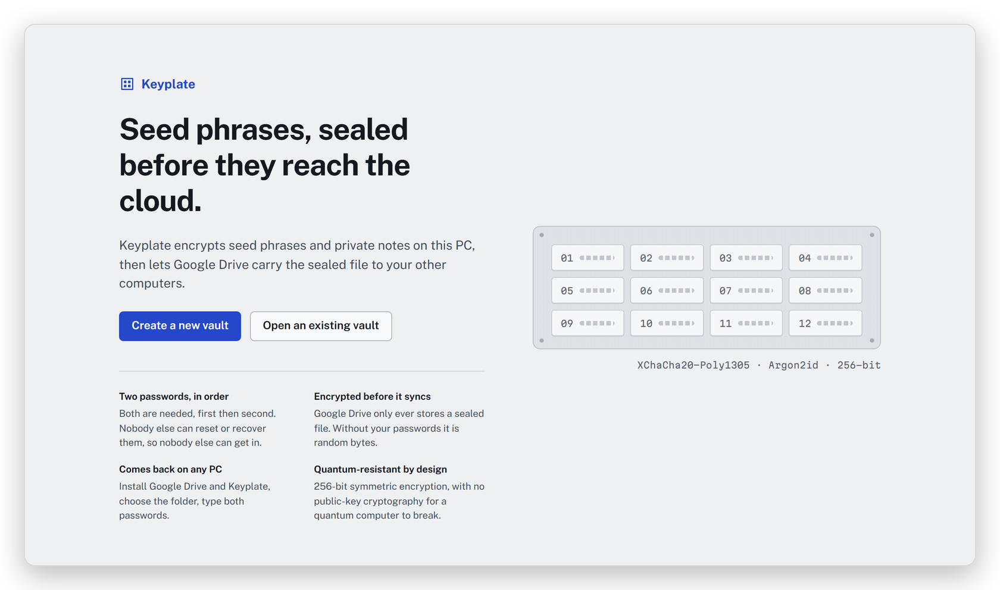
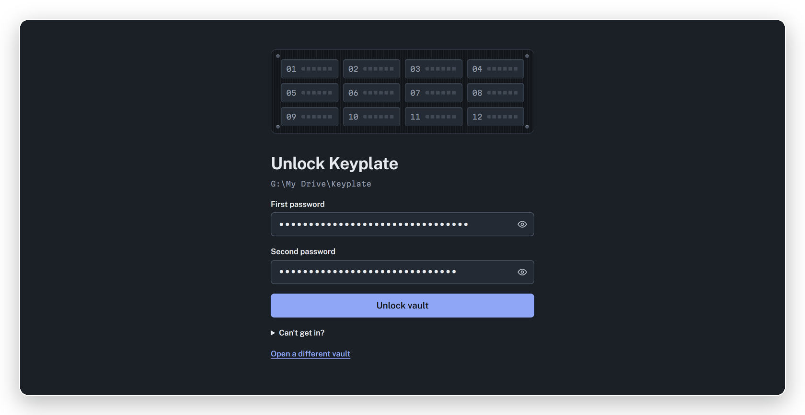
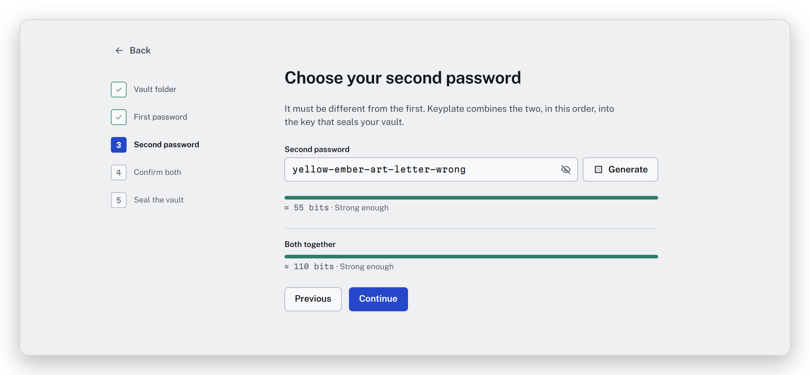
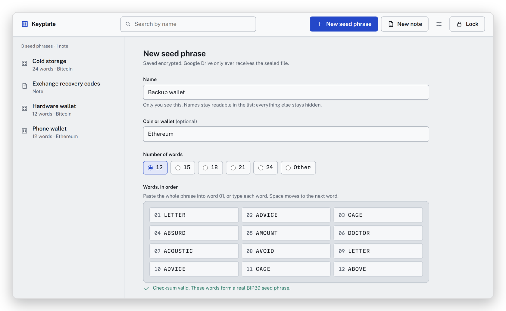
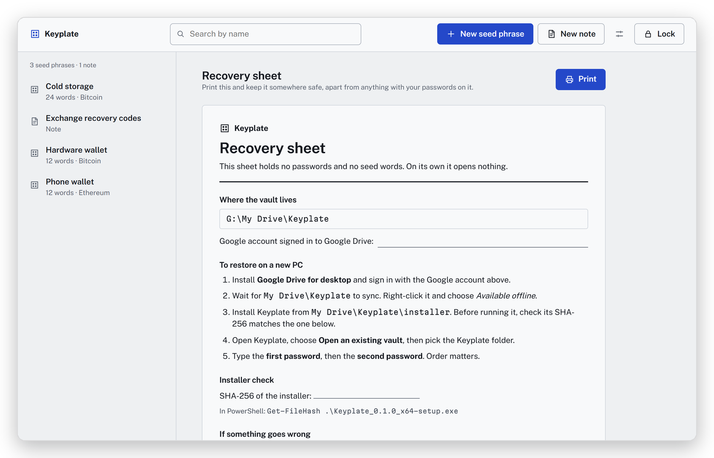

<div align="center">



# Keyplate

**Seed phrases, sealed before they reach the cloud.**

An encrypted vault for crypto seed phrases and private notes. Two passwords, quantum-resistant encryption,<br>
and a sealed file that Google Drive carries to your other PCs.

[](https://github.com/0xHookless/KeyPlate/releases/latest)


[](LICENSE)

[**Download for Windows**](https://github.com/0xHookless/KeyPlate/releases/latest) &nbsp;·&nbsp;
[Security model](docs/SECURITY.md) &nbsp;·&nbsp;
[Restore on a new PC](docs/RECOVERY.md)

</div>

<br>

<picture>
  <source media="(prefers-color-scheme: dark)" srcset="docs/images/vault-dark.png">
  
</picture>

<p align="center"><sub>Screenshots show demo data: public BIP39 test vectors, never real seeds.</sub></p>

## Why Keyplate

- **Two passwords, in order.** Both feed one key. Swapping them or getting either wrong opens nothing, and nobody
  else (not Google, not Keyplate) can reset or recover them.
- **Sealed before it syncs.** Everything is encrypted on your PC. Google Drive only ever stores a sealed file, so a
  hijacked Google account gets random bytes.
- **Comes back on any PC.** Install Google Drive and Keyplate, choose the folder, type both passwords. The last 30
  saves are kept, and edits from two PCs merge.
- **Quantum-resistant by design.** 256-bit symmetric encryption only, with no public-key cryptography for a
  quantum computer to break.
- **Catches seed typos.** Words are checked against the BIP39 list as you type, with suggestions and a checksum
  check.
- **Stays out of sight.** The window is invisible to screenshots, screen sharing and Windows Recall. Copies skip
  clipboard history and clear themselves. The vault locks when you walk away.
- **Never goes online.** The app has no network code at all. Syncing is entirely Google Drive's job.

## A look inside

<table>
  <tr>
    <td width="50%">
      <picture>
        <source media="(prefers-color-scheme: dark)" srcset="docs/images/welcome-dark.png">
        
      </picture>
      <p align="center"><b>Start</b><br><sub>Create a vault, or open the one already in your Drive.</sub></p>
    </td>
    <td width="50%">
      
      <p align="center"><b>Unlock</b><br><sub>First password, then second. Order matters.</sub></p>
    </td>
  </tr>
  <tr>
    <td width="50%">
      
      <p align="center"><b>Strong passwords, measured</b><br><sub>Generate gives 55 bits per passphrase; weak pairs are refused.</sub></p>
    </td>
    <td width="50%">
      
      <p align="center"><b>Live seed checks</b><br><sub>Paste or type the words; typos and bad checksums are flagged.</sub></p>
    </td>
  </tr>
  <tr>
    <td colspan="2">
      
      <p align="center"><b>Printable recovery sheet</b><br><sub>The steps to restore on a new PC. It holds no secrets.</sub></p>
    </td>
  </tr>
</table>

## How it keeps your seeds safe

```
your two passwords ──► Argon2id (512 MiB, ~1 s) ──► HKDF-SHA-512 ──► key-encryption key
                                                                         │ unwraps
                       random 256-bit vault key ◄────────────────────────┘
                                 │ XChaCha20-Poly1305
                                 ▼
                     vault.keyplate in My Drive\Keyplate  (every byte authenticated)
```

| If someone… | …they get |
|---|---|
| takes over your Google account | a sealed file. Each password guess costs 512 MiB of memory and about a second. |
| steals or finds your PC | the same sealed file. The key only exists in memory while the vault is unlocked. |
| edits the file | nothing. Any changed byte makes it refuse to open. |
| reads the source code | nothing useful. Security rests on your passwords alone, not on secrecy of the design. |

**Quantum resistance.** Shor's algorithm breaks public-key cryptography, and Keyplate uses none to protect your
data. Grover's algorithm at best halves a symmetric key's strength, which leaves 256-bit keys at about 128-bit
security. Data is sealed before upload, so "harvest now, decrypt later" gets an attacker nothing. Full details are in
[docs/SECURITY.md](docs/SECURITY.md).

> [!NOTE]
> Keyplate 0.1 has not had an independent security audit. Try it with test data first, and keep an offline backup
> (paper or metal) of any seed that holds real funds.

## Install

1. Download `Keyplate_0.1.0_x64-setup.exe` from the [latest release](https://github.com/0xHookless/KeyPlate/releases/latest).
2. Check it in PowerShell and compare with the SHA-256 on the release page:
   ```powershell
   Get-FileHash .\Keyplate_0.1.0_x64-setup.exe
   ```
3. Run it. It installs for your user only and needs no admin rights. The installer isn't code-signed yet, so
   SmartScreen will warn: choose *More info*, then *Run anyway*, but only after the hash matched.
4. Install [Google Drive for desktop](https://www.google.com/drive/download/), then create your vault in
   `My Drive\Keyplate`.

**Restoring on a new PC:** install Google Drive and Keyplate, choose *Open an existing vault*, pick the folder, type
both passwords. See [docs/RECOVERY.md](docs/RECOVERY.md).

## Build from source

Needs Rust (MSVC toolchain), Node.js 20+ and WebView2 (already part of Windows 11).

```bash
npm install
cargo test --workspace          # crypto, file format, merge, storage and two-PC sync tests
npm run check                   # Svelte + TypeScript
npm run dev                     # UI only, in a browser, with demo data (?stage=welcome|locked|unlocked)
npm run tauri dev               # the real app
```

Release builds go through a script. It rewrites local folder paths so the binary names no user folder, links no
PDB, refuses to finish if either slipped through, and writes the installer's SHA-256:

```powershell
powershell -ExecutionPolicy Bypass -File scripts\build-release.ps1
```

| Path | What |
|---|---|
| `crates/vault-core` | Pure Rust, no I/O: file format, key derivation, encryption, merge, BIP39 checks, password rules. |
| `src-tauri` | Tauri 2 shell: commands, unlocked session, auto-lock, Drive-folder storage, Windows hardening. |
| `src` | Svelte 5 UI in the Steel Plate design. `src/lib/tokens.css` holds every color, font and space. |

## License

[MIT](LICENSE)

## Contact

For business inquiries: jayknocks12@gmail.com
